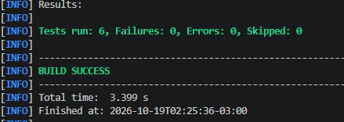
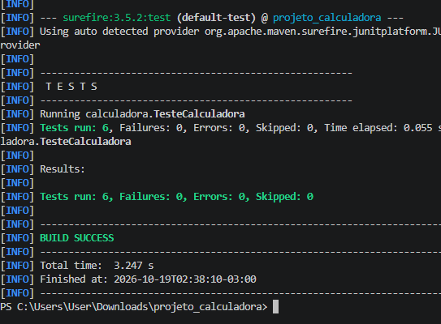
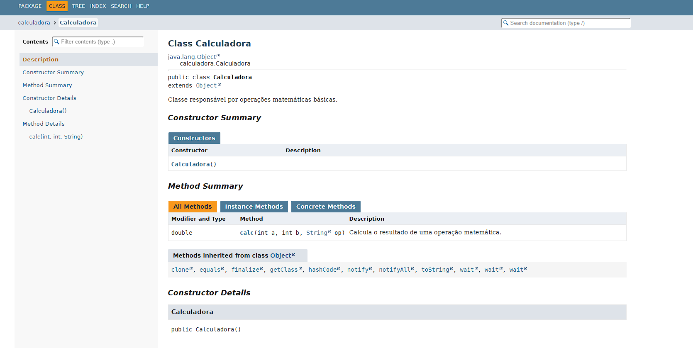
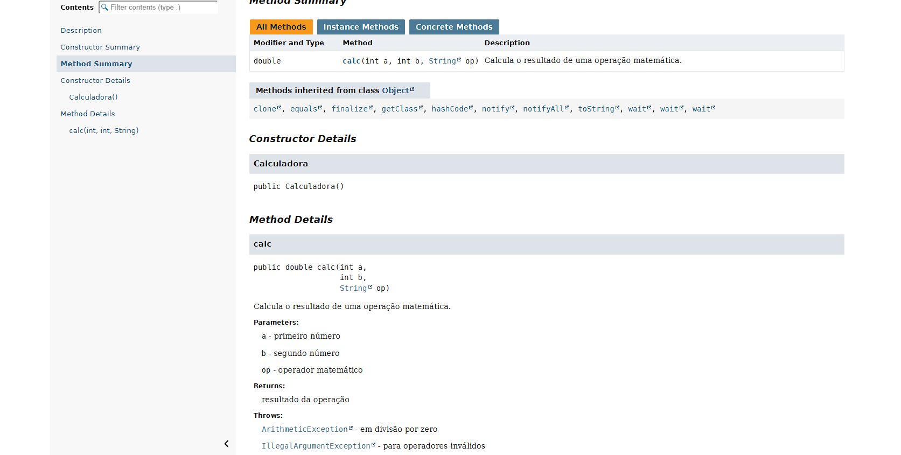
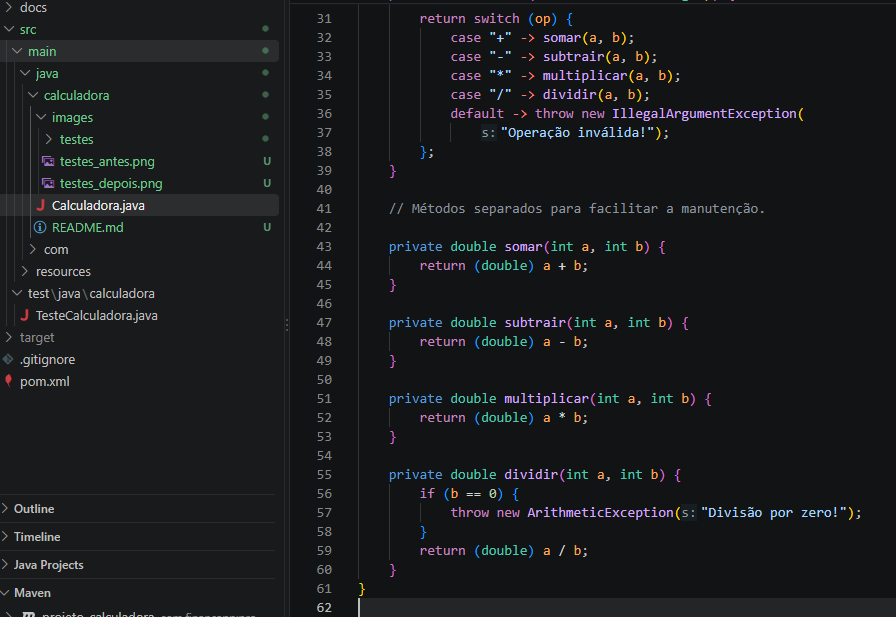

# Projeto Calculadora — FinançApp

> Projeto acadêmico desenvolvido com foco em Qualidade de Software, Testes, Refatoração, Documentação e Versionamento.

---

## 1. Identificação do Projeto

**Projeto:** Projeto Calculadora  
**Contexto:** FinançApp  
**Aluno:** Giovanni Paulossi Cassemiro Dantas  
**RA:** 250990  
**Curso:** Análise e Desenvolvimento de Sistemas  
**Disciplina:** UX/UI e Testes de Software  
**Professor:** Daniel Domingos Akira de Sa Pimentel Ohata  
**Semestre:** 2026.2

---

# 2. Visão Geral

O projeto consiste no desenvolvimento de um módulo de cálculos matemáticos básicos em Java para a startup fictícia **FinançApp**.

O módulo foi desenvolvido para ser utilizado futuramente em funcionalidades de controle financeiro, como:

- orçamento mensal;
- divisão de despesas;
- projeções financeiras;
- cálculos auxiliares.

Além do funcionamento correto das operações, o projeto aplica práticas de qualidade de software relacionadas a:

- testes;
- tratamento de erros;
- refatoração;
- documentação;
- versionamento;
- manutenção de código.

---

# 3. Problema

Durante o desenvolvimento da aplicação FinançApp, foi identificada a necessidade de criar um módulo matemático reutilizável.

Entretanto, a equipe definiu que o módulo não deveria apenas funcionar corretamente, mas também apresentar:

- código legível;
- testes automatizados;
- tratamento de falhas;
- documentação técnica;
- controle de versões;
- facilidade de manutenção.

O desafio consiste em desenvolver uma solução funcional e aplicar boas práticas de Engenharia de Software.

---

# 4. Objetivo

## 4.1 Objetivo Geral

Desenvolver uma calculadora em Java aplicando práticas de qualidade, testes, documentação, refatoração e versionamento.

## 4.2 Objetivos Técnicos

- implementar operações matemáticas básicas;
- tratar entradas inválidas;
- impedir divisão por zero;
- desenvolver testes automatizados;
- refatorar o código sem alterar seu comportamento;
- documentar classes e métodos com JavaDoc;
- gerar documentação HTML;
- utilizar Git e GitHub;
- organizar commits e branches;
- manter documentação técnica no README.

---

# 5. Escopo Funcional

A aplicação oferece as seguintes operações:

| ID | Funcionalidade | Descrição | Status |
|---|---|---|---|
| RF01 | Soma | Soma dois números inteiros | ✅ |
| RF02 | Subtração | Subtrai dois números inteiros | ✅ |
| RF03 | Multiplicação | Multiplica dois números inteiros | ✅ |
| RF04 | Divisão | Divide dois números inteiros | ✅ |
| RF05 | Validação de divisão | Impede divisão por zero | ✅ |
| RF06 | Operação inválida | Trata operadores não suportados | ✅ |

---

# 6. Requisitos Não Funcionais

| ID | Categoria | Requisito |
|---|---|---|
| RNF01 | Qualidade | Código organizado e legível |
| RNF02 | Testabilidade | Testes automatizados das operações |
| RNF03 | Manutenção | Refatoração sem alteração funcional |
| RNF04 | Documentação | Classes e métodos documentados com JavaDoc |
| RNF05 | Versionamento | Controle de versões com Git e GitHub |
| RNF06 | Confiabilidade | Tratamento de operações inválidas e divisão por zero |

---

# 7. Tecnologias Utilizadas

| Tecnologia | Versão | Utilização |
|---|---|---|
| Java | 25 | Desenvolvimento |
| JDK | 25 | Compilação |
| JUnit | 5.11.4 | Testes unitários |
| Apache Maven | 3.10.0 | Gerenciamento do projeto |
| Git | 2.56.0 | Controle de versão |
| GitHub | — | Repositório remoto |
| JavaDoc | JDK 25 | Documentação |
| VS Code | — | Ambiente de desenvolvimento |

---

# 8. Estrutura do Projeto

```text
projeto_calculadora/
│
├── src/
│   ├── main/
│   │   └── java/
│   │       └── calculadora/
│   │           └── Calculadora.java
│   │
│   └── test/
│       └── java/
│           └── calculadora/
│               └── TesteCalculadora.java
│
├── docs/
│   └── index.html
│
├── images/
│   ├── testes/
│   ├── javadoc/
│   └── refatoracao/
│
├── pom.xml
├── README.md
└── .gitignore
```

---

# 9. Testes Unitários

Foram desenvolvidos seis testes automatizados utilizando JUnit 5, abrangendo soma, subtração, multiplicação, divisão, divisão por zero e operações inválidas.

**Resultado obtido:**

- Testes executados: 6
- Falhas: 0
- Erros: 0
- Resultado: BUILD SUCCESS

Os testes foram executados antes e depois da refatoração.

---

# 10. Refatoração

Foi criada a branch `Refatoracao` para reorganizar a classe Calculadora.

As melhorias realizadas incluem:

- extração de métodos;
- simplificação das estruturas condicionais;
- organização das operações matemáticas;
- melhoria da legibilidade;
- manutenção do comportamento original.

Após a refatoração, os seis testes foram executados novamente com sucesso.

---

# 11. Documentação JavaDoc

A documentação técnica foi gerada utilizando JavaDoc e está disponível na pasta `docs/`.

O arquivo `docs/index.html` permite consultar a classe Calculadora, seus métodos, parâmetros, retorno e exceções.

---


# 12. Evidências

## Testes antes da refatoração


## Testes depois da refatoração


## Documentação JavaDoc




## Código refatorado


---

# 13. Repositório GitHub

Link do repositório: https://github.com/giovanni-gijo/projeto_calculadora

Branches utilizadas:

- `main`: implementação inicial.
- `Refatoracao`: melhorias e documentação do projeto.
